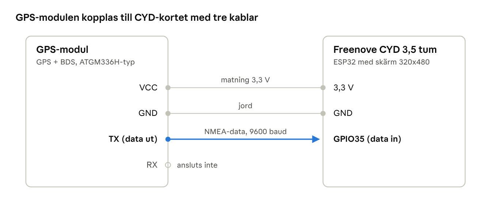
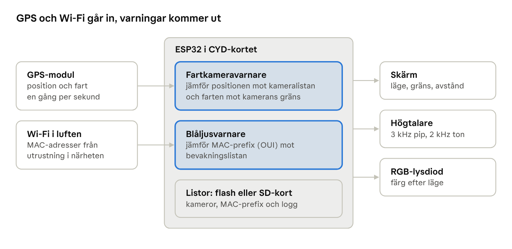
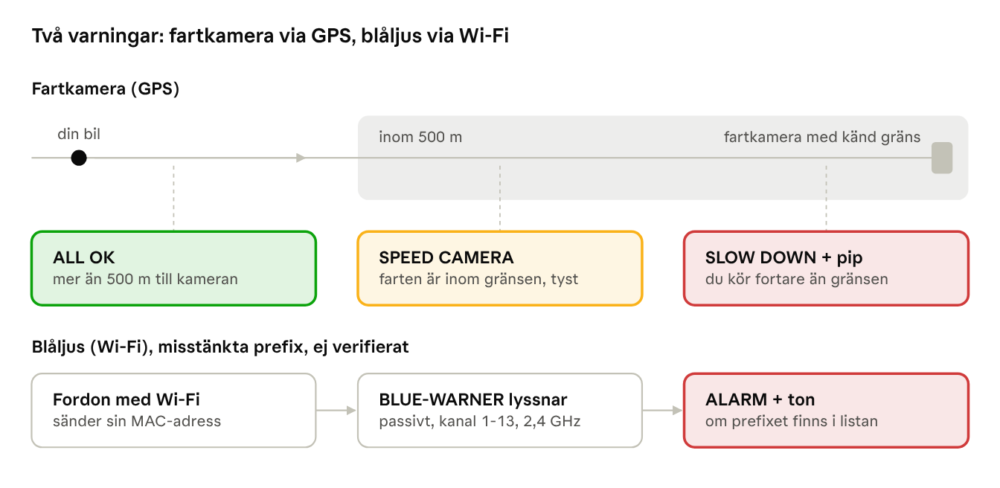
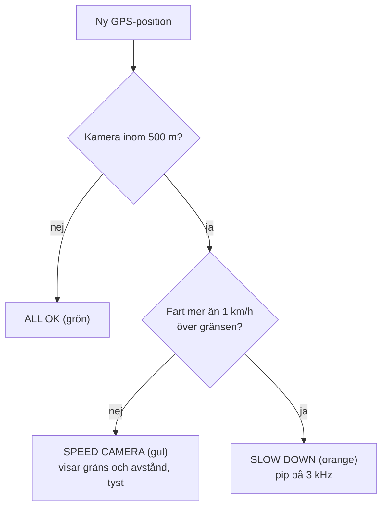
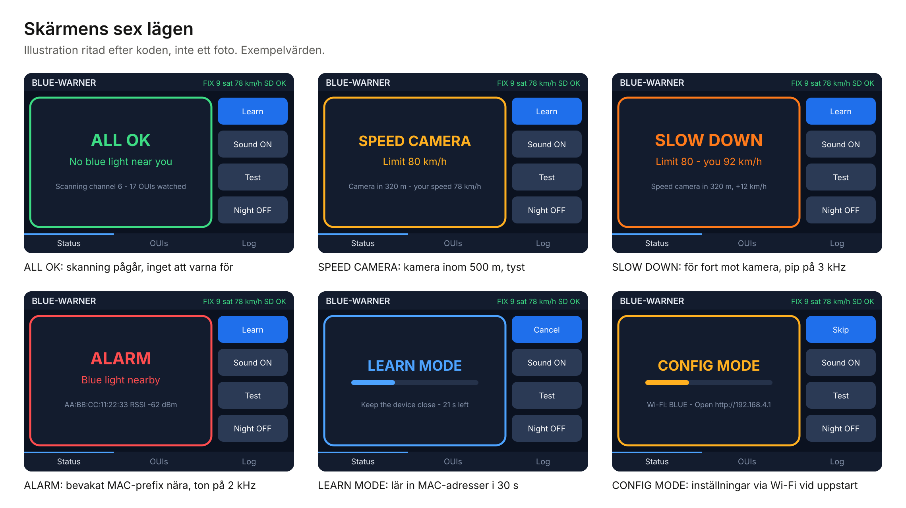

# BLUE-WARNER

Varnare för bilen byggd på en Freenove ESP32-skärm (CYD, 3,5 tum) och en GPS-mottagare. Den gör två saker:

- **Fartkameravarnare** – närmar du dig en fartkamera och kör för fort varnar enheten med text och pip.
- **Blåljusvarnare** – närmar du dig ett misstänkt blåljusfordon larmar enheten med röd skärm och ton.

Allt sker lokalt i enheten. Den sänder ingenting och behöver varken mobil eller internet under körning.

> [!WARNING]
> **Blåljuslistan är inte verifierad.** De förinlagda MAC-prefixen är sådana som jag *misstänker* används av Wi-Fi-utrustningen i polisens och räddningstjänstens fordon. Det är inte bekräftat. Larmet kan både utebli och lösa ut för helt andra fordon och enheter.

Utvecklad av A. Isaksson, SA7BNB.

## Innehåll

- [Hårdvara](#hårdvara)
- [Inkoppling](#inkoppling)
- [Så fungerar det](#så-fungerar-det)
- [Skärmlägen och ljud](#skärmlägen-och-ljud)
- [Installation i Arduino IDE](#installation-i-arduino-ide)
- [Uppstart och konfiguration](#uppstart-och-konfiguration)
- [SD-kort](#sd-kort)
- [Kameradatabasen: download_database.py](#kameradatabasen-download_databasepy)
- [Felsökning](#felsökning)
- [Begränsningar](#begränsningar)
- [Filer i repot](#filer-i-repot)

## Hårdvara

| Del | Produkt | Köpt från |
| --- | --- | --- |
| Skärm och processor | [Freenove ESP32 Display CYD Touch Screen 3.5 Inch 320x480 Pixel TN](https://www.amazon.se/dp/B0GVXG9HDV) | Amazon.se |
| GPS-mottagare | [GPS+BDS Beidou Dual-Mode Module (ATGM336H-ersättare, för NEO-M8N)](https://www.aliexpress.com/item/1005002106176312.html) | AliExpress |
| microSD-kort | Valfritt, för logg och egna listor | – |

Det här använder koden på CYD-kortet:

| Funktion | Används till | Pinnar |
| --- | --- | --- |
| TFT-skärm ST7796, 320×480, resistiv touch | Gränssnitt (LVGL 8.4), liggande läge | HSPI 13/12/14 |
| Wi-Fi 2,4 GHz | Passiv lyssning och konfigurations-AP | inbyggt |
| GPS-ingång (UART2, 9600 baud) | NMEA från GPS-modulen | GPIO35 |
| Högtalare | Larmtoner | GPIO26 och 25, förstärkare på GPIO4 |
| RGB-lysdiod | Statusfärg | GPIO22/16/17 |
| Bakgrundsbelysning | Dag- och nattläge (PWM) | GPIO27 |
| microSD | Logg, OUI-lista, kameralista | VSPI 5/18/19/23 |

## Inkoppling

GPS-modulen kopplas till CYD-kortet med tre kablar.

| GPS-modul | CYD-kort | Funktion |
| --- | --- | --- |
| TX | GPIO35 | NMEA-data från GPS till ESP32, 9600 baud |
| GND | GND | Jord |
| VCC | 3,3 V | Matning |
| RX | ansluts inte | Enheten skickar inget till GPS:en |



GPIO35 är en ren ingång på ESP32, vilket passar här eftersom enheten bara lyssnar på GPS:en. Placera GPS-antennen med fri sikt mot himlen, till exempel på instrumentbrädan.

## Så fungerar det

Två signaler går in i enheten, GPS-data och Wi-Fi-trafik, och tre saker kommer ut: skärmbild, ljud och lysdiodens färg.





### Fartkameravarnaren

1. GPS-modulen skickar position och fart en gång per sekund (NMEA-meningen RMC). Antal satelliter läses ur GGA.
2. Vid varje ny position jämförs den mot alla kameror i listan, 2 482 stycken i den bifogade filen.
3. Finns en kamera inom 500 m väljs den närmaste. Skärmen visar gränsen, avståndet och din fart.
4. Är farten mer än 1 km/h över gränsen blir det "SLOW DOWN" med pip på 3 kHz.
5. När kameran är mer än 500 m bort återgår skärmen, och händelsen loggas som passerad.



Pipen kommer tätare ju mer för fort du kör:

| Över gränsen | Pip |
| --- | --- |
| 2–5 km/h | varannan sekund |
| 6–10 km/h | en gång per sekund |
| 11–20 km/h | två gånger per sekund |
| mer än 20 km/h | drygt tre gånger per sekund |

Tappar enheten GPS-positionen i mer än 5 sekunder släcks kameravarningen tills positionen är tillbaka.

### Blåljusvarnaren

1. ESP32:ans Wi-Fi står i lyssningsläge (promiscuous mode). Den ansluter inte till något nät och sänder inget.
2. Den hoppar mellan kanal 1–13 på 2,4 GHz och stannar 150 ms på varje. Ett helt varv tar cirka 2 sekunder.
3. För varje uppfångat paket jämförs de tre första byten i MAC-adressen (OUI, tillverkarens prefix) mot bevakningslistan. Sändare, BSSID och mottagare kontrolleras.
4. Paket svagare än −85 dBm ignoreras, så att bara närliggande utrustning ger larm.
5. Vid träff visas "ALARM – Blue light nearby" med MAC-adress och signalstyrka, och en pulserande ton på 2 kHz hörs. Larmet ligger kvar i 6 sekunder efter senaste träffen.


Förinlagda prefix (**misstänkta, ej verifierade**):

```
00:A0:D5  28:A3:31  50:13:9D  58:FC:C8  64:CE:6E  84:DB:2F
CC:93:4A  0C:FE:5D  00:1E:42  20:97:27  00:07:7C  00:11:B4
B4:56:F3  00:21:7E  00:80:25  48:02:AF  9C:BA:C9
```

Listan rymmer högst 64 prefix och ändras via konfigurationssidan, skärmens OUI-flik eller filen `/oui.txt` på SD-kortet.

## Skärmlägen och ljud

Skärmen visar ett läge i taget, och det viktigaste vinner. Tabellen är sorterad efter prioritet, högst överst.

| Läge | Färg | Betyder | Ljud |
| --- | --- | --- | --- |
| CONFIG MODE | Gul | Uppstart: Wi-Fi-AP för inställningar är igång | – |
| LEARN MODE | Blå | Lär in MAC-adresser i 30 s | Kort pip vid start och slut |
| SLOW DOWN | Orange | Kamera inom 500 m och du kör för fort | Korta pip, 3 kHz |
| ALARM | Röd | Bevakat MAC-prefix hörs i närheten | Pulserande ton, 2 kHz |
| SPEED CAMERA | Gul | Kamera inom 500 m, farten är inom gränsen | – |
| ALL OK | Grön | Skanning pågår, inget att varna för | – |



*Bilden är en illustration ritad efter koden, inte ett foto av enheten.*

De två larmen har olika tonhöjd för att gå att skilja åt utan att titta på skärmen. Inträffar båda samtidigt visas SLOW DOWN, med raden "Blue light nearby" under.

Skärmen har tre flikar: **Status**, **OUIs** (bevakningslistan) och **Log** (händelser sedan start). Statusfliken har fyra knappar:

- **Learn** – startar inlärning. Under uppstarten heter knappen Skip och hoppar direkt till skanning.
- **Sound ON/OFF** – stänger av eller slår på allt ljud.
- **Test** – spelar en kort testton.
- **Night ON/OFF** – nattläge: bakgrundsbelysningen sänks till cirka 5 %, bilden mörkas och lysdioden släcks utom vid rött larm. Valet sparas till nästa start.

## Installation i Arduino IDE

Två inställningar måste vara rätt: kortet **ESP32 Dev Module** och partitionsschemat **Huge APP (3MB No OTA)**. Programmet med LVGL och kameralistan får inte plats i standardpartitionen.

| Inställning (menyn Verktyg) | Värde |
| --- | --- |
| Kort (Board) | ESP32 Dev Module |
| Partition Scheme | Huge APP (3MB No OTA) |
| Port | Den COM-port som dyker upp när kortet ansluts med USB |
| Seriell monitor | 115200 baud |

Övriga inställningar kan stå kvar på standardvärdena. Kortstödet installeras via Kortadministratören: paketet "esp32" från Espressif Systems. Koden fungerar med både version 2.x och 3.x av det paketet.

**Bibliotek:** använd de som följer med Freenoves exempelpaket, LVGL 8.4.0 och TFT_eSPI, med Freenoves `lv_conf` och skärminställningar. Uppdatera dem inte även om Arduino IDE föreslår det. LVGL 9 fungerar inte med den här koden.

Steg för steg:

1. Följ Freenoves anvisningar så att deras exempel `Sketch_13.1_LVGL` går att ladda upp och visar bild på 3,5-tumsskärmen. Då är bibliotek och skärmmodell (`FNK0114N_3P5_320x480_ST7796`) rätt inställda.
2. Kopiera mappen `Sketch_13.1_LVGL` och döp kopian till `BLUE_WARNER_GPS`.
3. Byt ut .ino-filen mot `BLUE_WARNER_GPS.ino`. Mappen och .ino-filen måste heta samma sak.
4. Lägg `display.h`, `display.cpp` och `speed_cameras_with_limits.h` i samma mapp.
5. Välj kort, partitionsschema och port enligt tabellen och klicka på Ladda upp.
6. Koppla in GPS-modulen enligt [Inkoppling](#inkoppling).

Skärmens riktning ställs i `display.h` med `TFT_DIRECTION`: 1 är liggande läge, 3 vänder bilden 180°.

## Uppstart och konfiguration

De första 30 sekunderna efter start går det att ändra bevakningslistan från mobilen. Därefter börjar skanningen av sig själv.

1. Enheten startar ett eget Wi-Fi: nätverk `BLUE`, lösenord `123456789`.
2. Anslut och öppna `http://192.168.4.1`.
3. Lägg till prefix (ett per rad, hela MAC-adresser går också bra), ta bort enskilda, töm listan eller återställ standardlistan.
4. Koppla från Wi-Fi:t. Skanningen startar ett par sekunder senare.

Ansluter ingen inom 30 sekunder startar skanningen direkt. GPS:en och kameravarningen fungerar även under konfigurationsläget.

**Learn-läget:** tryck på Learn och håll enheten nära den utrustning du vill lära in. Under 30 sekunder samlas de 10 starkaste MAC-adresserna, och deras prefix läggs till i listan. Använd det där få andra Wi-Fi-enheter finns, annars hamnar även grannens router i listan.

## SD-kort

SD-kortet är valfritt. Bevakningslistan ligger alltid i RAM under drift och sparas i enhetens flashminne. Finns ett kort läses filerna en gång vid start, och all skrivning sker i en bakgrundstråd.

| Fil | Innehåll |
| --- | --- |
| `/oui.txt` | Bevakade prefix, ett per rad (AA:BB:CC). Kan redigeras på dator. Gäller före kopian i flash. |
| `/oui_log.csv` | Händelselogg: tid sedan start, typ, MAC, signalstyrka |
| `/oui_learned.csv` | Fullständiga MAC-adresser från Learn-läget |
| `/cameras.csv` | Egen kameralista, en rad per kamera: `lat,lon,gräns` |
| `/speed_cameras_with_limits.h` | Samma lista i .h-format, kopierad som den är |

Finns ingen kamerafil på kortet används listan som kompilerats in i programmet.

## Kameradatabasen: download_database.py

`download_database.py` körs på en dator och skapar `speed_cameras_with_limits.h`, listan över Sveriges fartkameror med hastighetsgräns. Kör det när du vill uppdatera kameralistan.

Programmet gör fyra saker:

1. Laddar ner Sverige-utdraget av OpenStreetMap från Geofabrik (`sweden-latest.osm.pbf`).
2. Plockar ut alla fartkameror, det vill säga noder märkta `highway=speed_camera`.
3. Kopplar varje kamera till en hastighetsgräns.
4. Skriver `speed_cameras_with_limits.h` och `speed_cameras.csv` i samma mapp.

Hastighetsgränsen hämtas i den här ordningen, och första träffen gäller:

1. `maxspeed` på själva kameran.
2. `maxspeed` på en enforcement-relation som kameran ingår i.
3. `maxspeed` på närmaste bilväg inom 40 m. Gång- och cykelvägar, stigar och liknande räknas inte.
4. Hastigheten i en äldre .h-fil, om du anger en och kameran ligger inom 30 m från en post där.
5. Annars skrivs 0, som betyder okänd.

```bash
python3 download_database.py                                        # normal körning
python3 download_database.py gammal_speed_cameras_with_limits.h    # med gammal fil som reserv
python3 download_database.py --ny                                   # tvinga ny nedladdning
```

Bra att veta:

- Programmet är skrivet för Linux. Första körningen skapar Python-miljön `~/osmvenv` och installerar pyosmium där automatiskt. Saknas venv: `sudo apt install python3-venv`.
- Det behöver ungefär 2 GB ledigt RAM, och inläsningen tar någon minut.
- OSM-filen sparas i mappen och återanvänds om den är högst 7 dagar gammal.
- När det är klart skriver programmet ut hur många hastigheter som kom från kamera, relation, väg, gammal fil respektive blev okända.

Den nya filen får du in i enheten på två sätt: lägg den i sketchmappen och ladda upp programmet igen, eller kopiera den till SD-kortets rot. SD-kortet kräver ingen omprogrammering.

## Felsökning

Öppna seriell monitor på 115200 baud. Varannan sekund skrivs en GPS-statusrad som säger om det kommer data på GPIO35, om baudraten verkar fel, eller om positionen är giltig. I koden står `GPS_DEBUG 2`, som även skriver ut varje rå NMEA-rad. Sätt den till 1 eller 0 när allt fungerar.

| Symptom | Prova |
| --- | --- |
| "Sketch too big" vid kompilering | Partition Scheme är inte Huge APP |
| "no GPS" på skärmen | Kontrollera GPS TX till GPIO35, GND och 3,3 V |
| Tecken kommer men inga giltiga rader | Fel baudrate, ändra `GPS_BAUD` (nu 9600) |
| Inget ljud | Kontrollera att Sound står på ON, testa med Test-knappen |
| Lysdiodens färger är omvända | Ändra `RGB_ACTIVE_LOW` till 0 |

## Begränsningar

Enheten är ett hobbybygge och ett hjälpmedel, inte en garanti.

- **Blåljuslistan är en gissning.** Prefixen är inte verifierade. Ett OUI pekar dessutom ut en tillverkare, inte ett fordon. Samma märke av router eller modem kan sitta i bussar, taxibilar, lastbilar och hem, och ger då falsklarm.
- **Tystnad betyder inte fritt.** Fordon utan Wi-Fi, med avstängt Wi-Fi, med annan utrustning eller enbart på 5 GHz upptäcks inte. Enheten lyssnar bara på 2,4 GHz.
- **Kameralistan kommer från OpenStreetMap.** Nya, flyttade eller saknade kameror och felaktiga hastighetsgränser förekommer. Mobila kontroller finns inte med alls.
- **Varningen tar inte hänsyn till körriktning.** Alla kameror inom 500 m fågelvägen varnar, även på motsatt körfält eller en parallell väg.
- **GPS-farten ligger någon sekund efter** och försvinner i tunnlar. Efter start tar det en stund innan första positionen kommer.
- **Känt fel:** 8 av de 2 482 kamerorna i den bifogade .h-filen har hastigheten 0 (okänd). När listan läses från SD-kortet hoppas de över, men den inkompilerade listan används som den är, så vid de kamerorna blir det "SLOW DOWN" så fort du rör dig. Lägg filen på SD-kortet för att slippa det.

## Filer i repot

| Fil | Innehåll |
| --- | --- |
| `BLUE_WARNER_GPS.ino` | Huvudprogrammet: Wi-Fi-lyssning, GPS, kamerakontroll, gränssnitt, konfigurationssida |
| `display.h`, `display.cpp` | Freenoves LVGL-wrapper för skärm och touch, med `TFT_DIRECTION` |
| `speed_cameras_with_limits.h` | Kameralistan som kompileras in (2 482 kameror) |
| `download_database.py` | Skapar en ny kameralista från OpenStreetMap |
| `images/` | Bilderna som visas i den här README-filen |

## Data och erkännanden

Kameradata: © OpenStreetMap-bidragsgivare, licens [ODbL](https://opendatacommons.org/licenses/odbl/), hämtad via [Geofabrik](https://download.geofabrik.de/europe/sweden.html). Skärmbibliotek och exempel från Freenove, grafik med LVGL.
